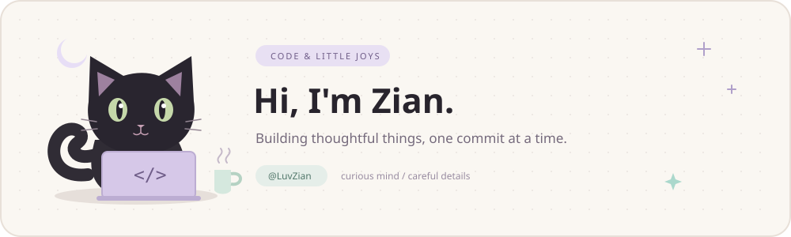
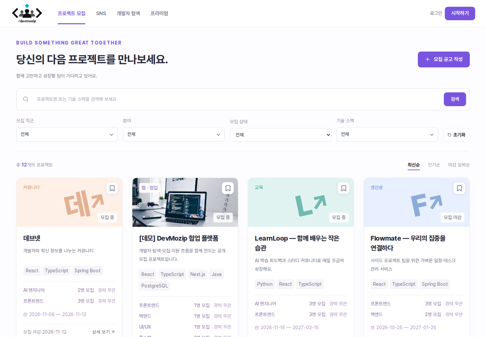

### 안녕하세요, 개발자 김선아입니다.

사용자가 편하게 쓰는 화면과, 그 뒤에서 자연스럽게 이어지는 흐름을 고민합니다. 
작은 불편함을 발견하고, 하나씩 더 나은 경험으로 다듬는 일을 좋아합니다.

[GitHub](https://github.com/LuvZian) · [대표 프로젝트](#featured-project) · [사용 기술](#tech-notes)

 

## About me

- **사용자 경험** — 버튼 위치, 문구, 화면 이동처럼 작은 디테일까지 살핍니다.
- **연결되는 기능** — 프로젝트 지원부터 팀 구성·협업·리뷰까지 이어지는 흐름을 만듭니다.
- **함께하는 개발** — 이슈와 PR로 작업을 나누고, 팀의 코드와 규칙에 맞춰 협업합니다.

## Featured project

<table>
<tr>
<td width="130" align="center" valign="top">

</td>
<td valign="top">

### DevMozip · 데브모집

**AI 기반 개발자 매칭 및 사이드 프로젝트 협업 플랫폼**

동료 탐색과 프로젝트 모집부터 팀 채팅, 포트폴리오, 협업 리뷰까지 연결하는 팀 프로젝트입니다.

**[서비스 방문 ↗](https://devmozip.newlecture.com)** · **[코드와 프로젝트 소개 ↗](https://github.com/likelion-backendschool-9th/DevMozip)**

</td>
</tr>
</table>

### 제가 맡은 부분

| 영역 | 작업 내용 |
| --- | --- |
| 프로젝트 모집·관리 | 공고 생성·수정·삭제, 지원·승인·팀원·프로젝트 상태 관리 및 API 연동 |
| 활동·리뷰·신뢰 온도 | 프로젝트 참여 이력, 협업 리뷰와 신뢰 온도 연결 |
| 저장 기능 | 프로젝트 북마크·좋아요 및 사용자 화면 연동 |
| 프론트엔드 | 초기 구조·공통 UI·화면 디자인과 사용 흐름 개선 |

프로젝트 화면 살펴보기

## Tech notes

프로젝트를 만들며 사용한 기술입니다.

| 분야 | 기술 |
| --- | --- |
| Backend | `Java` `Spring Boot` `Spring Data JPA` |
| Frontend | `TypeScript` `React` `Next.js` `CSS Modules` |
| Data | `PostgreSQL` `JSONB` |
| Workflow | `Git` `GitHub` `Docker` `Figma` `Notion` `Herdr` |

 

**작은 디테일을 모아, 쓰기 좋은 서비스를 만듭니다.**

a little curiosity, a little care, one more commit.

