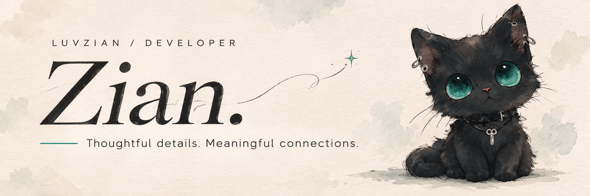

 

**사용자의 경험과 서비스의 흐름을 함께 고민하는 개발자, 김선아입니다.**

작은 불편함을 발견하고, 화면부터 데이터까지 자연스럽게 이어지는 기능을 만듭니다. 
프로젝트에서 마주한 문제를 정리하고, 팀과 함께 더 나은 방향을 찾아갑니다.

[GitHub](https://github.com/LuvZian) &nbsp; / &nbsp; [Selected Projects](#selected-projects) &nbsp; / &nbsp; [Tech Stack](#tech-stack)

 

## Selected Projects

직접 구현하고 다듬어 온 프로젝트들입니다.

<!-- 프로젝트를 추가할 때 아래 PROJECT CARD 블록 전체를 복사하고 링크·역할·기술을 바꿉니다. -->
<!-- PROJECT CARD START: DevMozip -->
<table>
<tr>
<td width="120" align="center" valign="top">
 

</td>
<td valign="top">

01 &nbsp; / &nbsp; TEAM PROJECT

### [DevMozip · 데브모집](https://github.com/likelion-backendschool-9th/DevMozip)

**개발자를 연결하고, 함께 만든 경험을 다음 협업으로 이어가는 플랫폼**

프로젝트 모집·지원부터 팀 관리, 포트폴리오와 협업 리뷰까지 연결합니다.

`Java` `Spring Boot` `PostgreSQL` `TypeScript` `Next.js`

**My work** &nbsp; 프로젝트 모집·관리 · 협업 리뷰·신뢰 온도 · 북마크·좋아요 · 프론트엔드 구조·UI

[서비스 방문 ↗](https://devmozip.newlecture.com) &nbsp; / &nbsp; [Repository ↗](https://github.com/likelion-backendschool-9th/DevMozip)

</td>
</tr>
</table>

<strong>DevMozip에서 맡은 구현</strong>

| 영역 | 구현 내용 |
| --- | --- |
| 프로젝트 | 공고 생성·수정·삭제, 지원·승인·팀원 관리와 실제 API 연동 |
| 협업 이력 | 프로젝트 활동, 종료 후 리뷰, 신뢰 온도 반영 |
| 저장 기능 | 프로젝트 북마크·좋아요와 사용자 목록 연동 |
| 사용자 경험 | 프론트엔드 초기 구조·공통 UI·디자인 및 화면 이동 개선 |

<!-- PROJECT CARD END -->

 

## Tech Stack

프로젝트에서 사용한 기술과 도구입니다.

| 분야 | 사용 기술 |
| --- | --- |
| **Backend** | Java · Spring Boot · Spring Data JPA |
| **Frontend** | TypeScript · React · Next.js · CSS Modules |
| **Database** | PostgreSQL · JSONB |
| **Workflow** | Git · GitHub · Docker · Figma · Notion · Herdr |

 

---

Thoughtful details. Meaningful connections.

